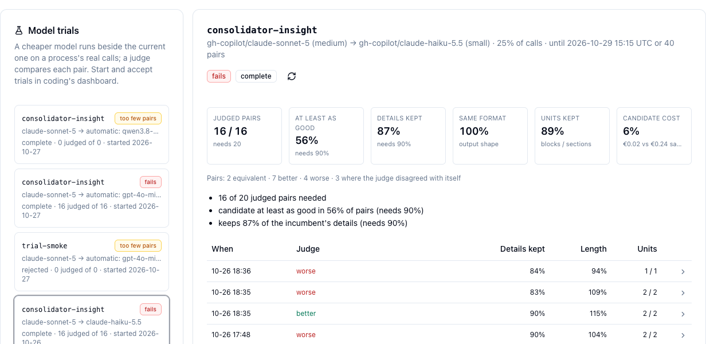

<div class="overview-deck" id="glass-job-classes" role="region" aria-label="glass job classes presentation" markdown="1">

<div class="overview-toolbar" hidden>
  <span class="overview-label">glass / job classes</span>
  <span class="overview-counter" role="status" aria-live="polite" aria-atomic="true"></span>
  <button type="button" data-fullscreen>Fullscreen</button>
</div>

<div class="overview-stage" markdown="1">

<section class="overview-slide overview-cover overview-essential" id="slide-1" aria-labelledby="gjc-title" markdown="1">
<div class="overview-copy" markdown="1">

<p class="overview-kicker">What kind of job is each prompt?</p>

# See what your work consists of {#gjc-title}

Every prompt you give an agent is one of a few **kinds of job**: fix something,
build it, ship it, check on it, explain it. glass labels each of your turns with
its kind, in the background, with **your own Copilot account**. It is opt-in and
off until you switch it on.

<div class="overview-benefits" markdown="1">

**Sort**  
Which kinds of job fill your days?

**Trust**  
Is the label right often enough to rely on?

**Share**  
One set of classes for the whole team.

</div>

</div>
<figure class="overview-figure" markdown="1">

[](images/ui-job-classes-tree.png){: target="_blank" rel="noopener" title="Open full-size screenshot" }

<figcaption>Token Usage → Classes: 18 made-up prompts on a test machine, sorted into classes.</figcaption>
</figure>
<p class="overview-takeaway">glass sorts and shows. The turn itself never changes.</p>
</section>

<section class="overview-slide overview-essential" id="slide-2" aria-labelledby="gjc-idea" markdown="1">
<div class="overview-copy" markdown="1">

<p class="overview-kicker">The idea in plain words</p>

## Not every job needs the strongest model {#gjc-idea}

Some of what you ask an agent is hard: finding why something broke. Much of it
is routine: commit and push, is it finished, rerun the tests. Today one strong,
expensive model answers all of it.

Knowing the kind of each job is the first step to paying less:

1. **Sort** every prompt into a kind of job. glass does this for you.
2. **Try** a cheaper model on past jobs of one kind, and compare the answers.
3. **Switch** that kind of job to the cheaper model only if it does it as well.

Steps 2 and 3 run on a machine with coding installed. The team shares the result.

</div>
<figure class="overview-figure" markdown="1">

| You type | Kind of job | A cheaper model? |
|---|---|---|
| "The export test fails since this morning, find out why." | fix | unlikely: an open search for a cause |
| "Add a CSV export to the trials tab." | build | to be tried |
| "Commit this and push." | ship | likely |
| "Is the benchmark finished?" | status | likely |
| "How does the router pick a band?" | explain | to be tried |

<figcaption>Made-up examples. Only a trial on real prompts decides which kinds can go cheaper.</figcaption>
</figure>
<p class="overview-takeaway">Sort the jobs first. Evidence decides the model later.</p>
</section>

<section class="overview-slide" id="slide-3" aria-labelledby="gjc-words" markdown="1">
<div class="overview-copy" markdown="1">

<p class="overview-kicker">Words used in this deck</p>

## Who does what {#gjc-words}

| Word | Meaning |
|---|---|
| **turn** | One message you send the agent, and all it does to answer. One label each. |
| **class** | A kind of job (fix, ship, status, …), defined by its **test**: which prompts belong. |
| **taxonomy** | All classes with their tests and examples: one versioned file. |
| **group** | Classes put together for reading: programming, operating, communicating. |

</div>
<figure class="overview-figure" markdown="1">

| Word | Meaning |
|---|---|
| **student** | The cheap, fast model (`claude-haiku-5.5`) that labels every turn. |
| **teacher** | The strong model (`claude-sonnet-5`). It re-labels a share of turns, and its labels count as right. |
| **gate** | The bar a class clears before its labels count as trusted: 90 % of the student's labels confirmed, over at least 20 checked turns. |
| **reference set** | Your past prompts that the teacher labelled twice, giving the same class both times. |

</figure>
<p class="overview-takeaway">The student labels, the teacher checks, the gate says when to trust a label.</p>
</section>

<section class="overview-slide overview-essential" id="slide-4" aria-labelledby="gjc-on" markdown="1">
<div class="overview-copy" markdown="1">

<p class="overview-kicker">Step 1 · in glass</p>

## Switch it on {#gjc-on}

1. `glass ui` → **Token Usage → Classes**, or in a terminal: `glass job-classes on`.
2. **Try the account** sends one made-up prompt and shows the label it got.
3. Tick **Label my turns**. It applies from the next turn on. No restart.

Each prompt is **redacted first** and sent only to your own GitHub Copilot
account, the one your `gh` login reaches. It uses a little of your Copilot quota
per turn. The agent's call has already gone out before the label is asked for,
so labelling never slows a turn down.

</div>
<figure class="overview-figure" markdown="1">

[](images/ui-job-classes-settings.png){: target="_blank" rel="noopener" title="Open full-size screenshot" }

<figcaption>Off until you tick Label my turns.</figcaption>
</figure>
<p class="overview-takeaway">Your account, your quota, redacted prompts. Nothing is sent anywhere else.</p>
</section>

<section class="overview-slide overview-essential" id="slide-5" aria-labelledby="gjc-measure" markdown="1">
<div class="overview-copy" markdown="1">

<p class="overview-kicker">Step 2 · in glass</p>

## Measure what you already asked {#gjc-measure}

Live labelling starts with your next turn. To see your past work at once:

```sh
glass job-classes measure --days 28 --max 200
```

glass reads your prompts from the **agents' own transcripts** (Claude Code,
Copilot CLI, VS Code), redacts them, and labels each one three times: twice by
the teacher, once by the student. Prompts where both teacher passes agree form
the **reference set**, which the tree and the map show.

Each prompt costs three calls, so start with a small `--max`. A rerun picks up
where the last one stopped.

</div>
<figure class="overview-figure" markdown="1">

```text
taxonomy job-classes-v2; 18 prompts in the last 7 days
54 calls (claude-sonnet-5 twice, claude-haiku-5.5 once),
each prompt redacted first

teacher vs itself      kappa 1.00
student vs teacher     94 % agree, kappa 0.94
largest class          docs 22 %
reference set          18 prompts, 18 with an agreed class
```

<figcaption>The run on the test machine, shortened. Kappa removes the agreement luck alone would give: 0 is chance, 1 is perfect.</figcaption>
</figure>
<p class="overview-takeaway">One command shows what weeks of prompts consisted of.</p>
</section>

<section class="overview-slide" id="slide-6" aria-labelledby="gjc-class" markdown="1">
<div class="overview-copy" markdown="1">

<p class="overview-kicker">Step 2, continued · in glass</p>

## Open a class {#gjc-class}

Click a class in the tree to see:

- its **test**, the rule a prompt must meet to belong to it;
- the **written examples** that ship with the taxonomy;
- the **prompts of yours** it holds, with their project.

Two rows at the bottom show where the classes don't fit your work:

- **none**: no class fits. If many prompts land here, a class is missing.
- **unclear**: the teacher's two passes disagreed, so a test isn't sharp enough.

Either one is worth telling your team's maintainer.

</div>
<figure class="overview-figure" markdown="1">

[](images/ui-job-classes-class.png){: target="_blank" rel="noopener" title="Open full-size screenshot" }

<figcaption>The class ship: a version-control or release operation on finished work.</figcaption>
</figure>
<p class="overview-takeaway">Every gap is either a class to add or a test to sharpen.</p>
</section>

<section class="overview-slide" id="slide-7" aria-labelledby="gjc-map" markdown="1">
<div class="overview-copy" markdown="1">

<p class="overview-kicker">Step 2, continued · in glass</p>

## Compare your projects {#gjc-map}

**Map** splits the same classes by project. On the test machine, `docs-site` is
mostly communicating, while `shop-api` is mostly operating.

**Reference set** shows the measurement. **Live turns** shows the turns labelled
since you switched labelling on.

</div>
<figure class="overview-figure" markdown="1">

[](images/ui-job-classes-map.png){: target="_blank" rel="noopener" title="Open full-size screenshot" }

<figcaption>Groups open to show their classes. Projects with few prompts are faded.</figcaption>
</figure>
<p class="overview-takeaway">Different projects, different kinds of work.</p>
</section>

<section class="overview-slide overview-essential" id="slide-8" aria-labelledby="gjc-gate" markdown="1">
<div class="overview-copy" markdown="1">

<p class="overview-kicker">Step 3 · in glass</p>

## The gate: can the label be trusted? {#gjc-gate}

For each class, the gate asks: **of the turns the student put in this class,
how many did the teacher put there too?**

- A class **passes** at 90 % or more, over at least 20 turns the teacher checked.
- Below 90 % it is **below the gate**: its test needs sharpening.
- With fewer than 20 checks it is still **collecting**.

With the teacher checking 25 % of turns, a class needs about 80 turns of its own
kind to pass. Raise **Teacher re-checks** to get there sooner. That uses more quota.

</div>
<figure class="overview-figure" markdown="1">

[](images/ui-job-classes-gate.png){: target="_blank" rel="noopener" title="Open full-size screenshot" }

<figcaption>Right after switching on, every class is still collecting.</figcaption>
</figure>
<p class="overview-takeaway">A class is trusted only after the teacher has confirmed it enough times.</p>
</section>

<section class="overview-slide" id="slide-9" aria-labelledby="gjc-team" markdown="1">
<div class="overview-copy" markdown="1">

<p class="overview-kicker">Share · in glass</p>

## Join your team's classes {#gjc-team}

The classes that ship with glass are a starting point. A team keeps its own in a
member's learning repo, under `job-classes/`. Ask the team's maintainer for the
repo's git URL:

```sh
glass job-classes join https://<host>/<owner>/<repo>.git
```

| Do | Command | In the tab |
|---|---|---|
| Get the newest version | `glass job-classes pull` | **Update** |
| Go back to the default | `glass job-classes leave` | **Use the default** |

The repo holds classes and their changelog, never prompts. Your labels and gate
counts stay on your machine.

</div>
<figure class="overview-figure" markdown="1">

[](images/ui-job-classes-team.png){: target="_blank" rel="noopener" title="Open full-size screenshot" }

<figcaption>glass fetches only the job-classes/ folder, with your normal git login.</figcaption>
</figure>
<p class="overview-takeaway">One taxonomy for the team, whether a colleague runs coding or only glass.</p>
</section>

<section class="overview-slide overview-essential" id="slide-10" aria-labelledby="gjc-split" markdown="1">
<div class="overview-copy" markdown="1">

<p class="overview-kicker">glass and coding</p>

## Where the saving happens {#gjc-split}

Most people only install glass. It labels, measures and shows on its own.
**Proving** a cheaper model and **routing** to it run on a machine with coding:

| | glass | coding |
|---|---|---|
| Label turns; tree, map, gate | ✅ | ✅ |
| Join a team's classes | ✅ | ✅ |
| Create and grow a team's classes | | ✅ |
| Replay a class on a cheaper model | | ✅ |
| Route a proven class cheaper | | ✅ pi, opencode, Copilot CLI |
| Offload easy calls to your endpoint | ✅ | |

</div>
<figure class="overview-figure" markdown="1">

[](images/glass-job-classes-split.png){: target="_blank" rel="noopener" title="Open full-size diagram" }

<figcaption>The team repo carries the classes to glass, and the evidence from coding.</figcaption>
</figure>
<p class="overview-takeaway">glass sorts and shows; coding proves and routes; the team shares both.</p>
</section>

<section class="overview-slide" id="slide-11" aria-labelledby="gjc-why" markdown="1">
<div class="overview-copy" markdown="1">

<p class="overview-kicker">glass and coding, continued</p>

## Why glass does not route by class {#gjc-why}

coding's proxy can send the rest of a turn to a cheaper model once that turn's
class has earned it. Three things together count as earned:

1. the class has **passed its gate**;
2. a **replay** has shown that the cheaper model answers this class as well,
   recorded in the team repo as `job-classes/evidence/<class>.json`;
3. the same provider serves the cheaper model in a **lower band**.

glass doesn't do this, for two reasons:

- glass sends every call to the model the agent chose. It changes a call only
  when you switch [offload](offload.md) on, and then only to your own endpoint.
- Replays rerun past turns in a sandbox, from coding's recordings of those
  turns. So the evidence is always produced on a coding machine.

</div>
<figure class="overview-figure" markdown="1">

```json
{
  "schema": 1,
  "class": "status",
  "verdicts": [{
    "candidate": "claude-haiku-5.5",
    "incumbents": ["claude-opus-5"],
    "agent": "pi",
    "pairs": 24,
    "sameCore": 23,
    "sameRate": 0.96
  }]
}
```

<figcaption>The shape of an evidence file, shortened, with made-up numbers. A glass user who joined the team repo gets it along with the classes, but glass doesn't read it.</figcaption>
</figure>
<p class="overview-takeaway">No model gets cheaper without evidence from real past turns.</p>
</section>

<section class="overview-slide" id="slide-12" aria-labelledby="gjc-trials" markdown="1">
<div class="overview-copy" markdown="1">

<p class="overview-kicker">Next to classes</p>

## Trials: can a cheaper model take over a background job? {#gjc-trials}

Classes are about **your** prompts. A **trial** is about a background process
that calls a model on its own, such as a summary or an insight writer.

A cheaper model runs beside the current one on that process's real calls, and a
judge compares each pair. The trial passes when the cheaper model is at least as
good in 90 % of at least 20 judged pairs, and keeps 90 % of the details.

Trials are started and accepted in coding's dashboard. On a machine that also
runs coding, glass shows them read-only under **Token Usage → Trials**.

</div>
<figure class="overview-figure" markdown="1">

[](images/ui-trials.png){: target="_blank" rel="noopener" title="Open full-size screenshot" }

<figcaption>This trial fails: the cheaper model was at least as good in only 56 % of the pairs.</figcaption>
</figure>
<p class="overview-takeaway">Same rule as for classes: a cheaper model has to prove itself first.</p>
</section>

</div>

<nav class="overview-controls" aria-label="Presentation controls" hidden>
  <button type="button" data-prev>Previous</button>
  <div class="overview-dots" aria-label="Choose a slide"></div>
  <button type="button" data-next>Next</button>
  <span class="overview-help">Arrow keys to navigate / F for fullscreen</span>
</nav>
<p class="overview-message" role="status" aria-live="polite"></p>

</div>
