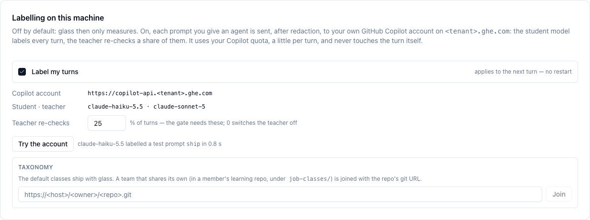
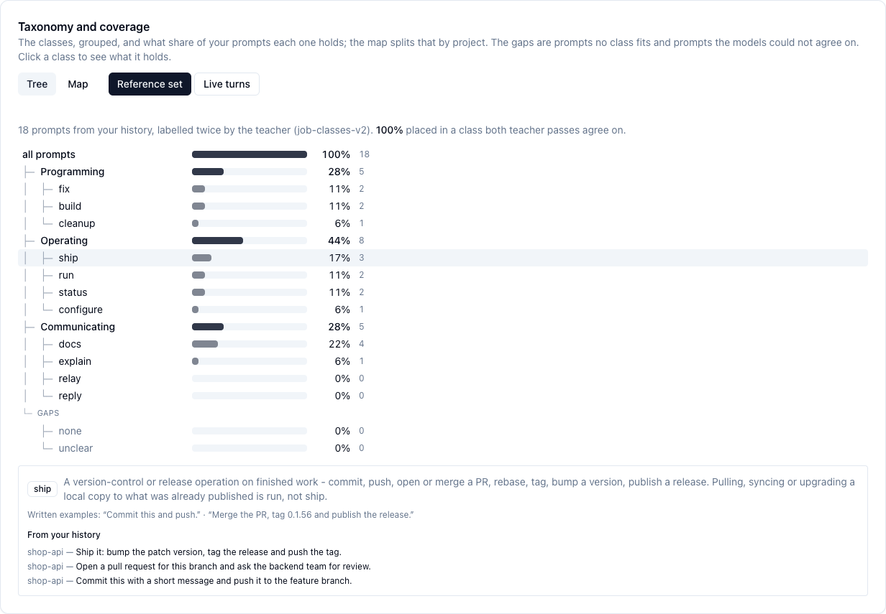
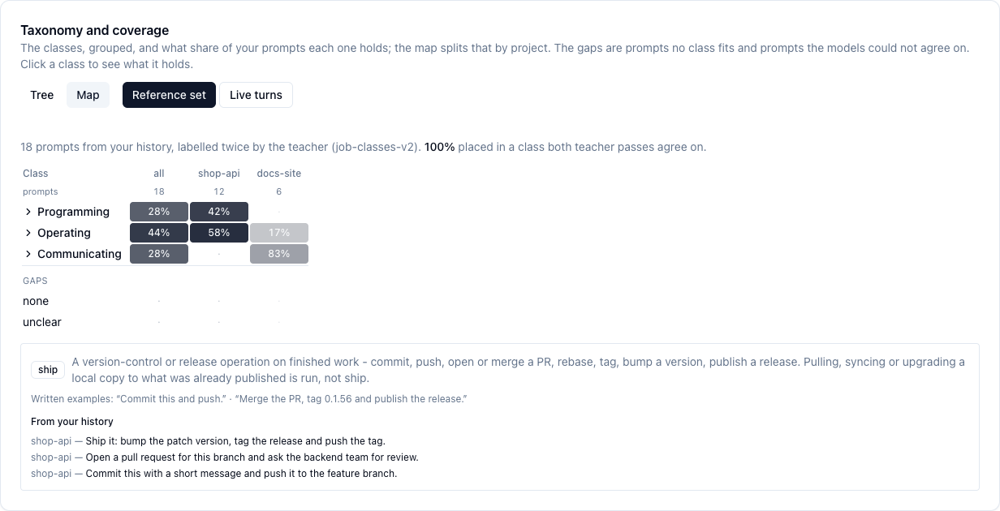
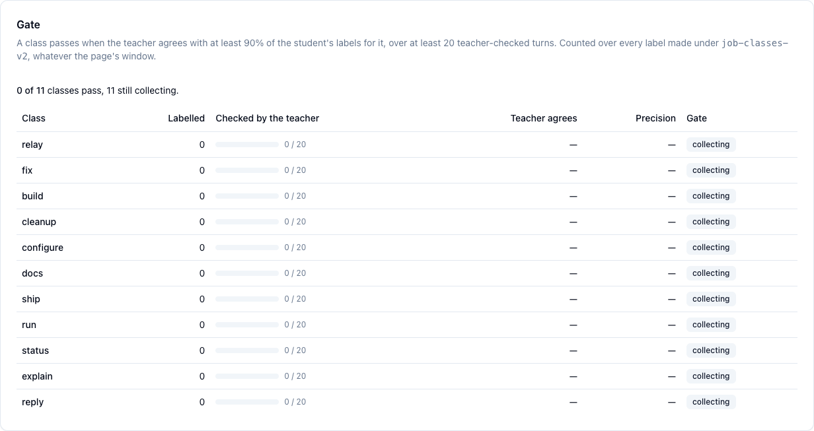
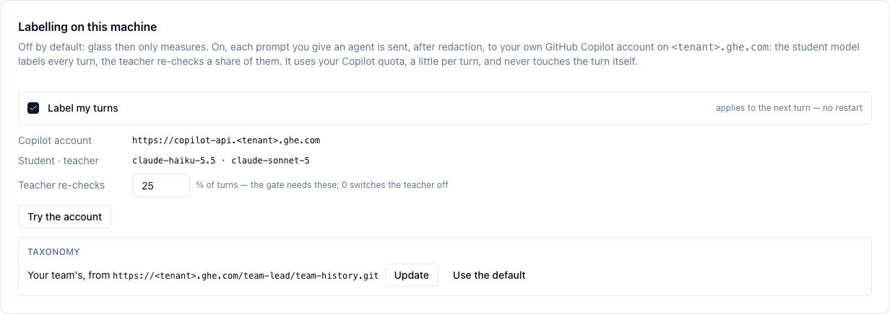

# Tutorial: Job Classes

Find out what kind of work you give your agents, in about 15 minutes. You switch labelling
on, measure your recent prompts, read the result, and join your team's classes. Every
screenshot below was taken on a test machine with 18 made-up prompts in two projects,
`shop-api` and `docs-site`. Your own numbers will differ.

**You need:** glass running (`glass doctor` shows ✓), and `gh` logged in to the GitHub host
of your Copilot account (`gh auth status`). Labelling uses that account, a little per turn.

## 1. Open the Classes tab

```sh
glass ui
```

Go to **Token Usage → Classes**. The first card, **Labelling on this machine**, starts off:
glass sends nothing anywhere until you tick the box.


| Field | What it means |
|---|---|
| **Copilot account** | Where the labels are asked for: your own Copilot account, on the host your `gh` login reaches. |
| **Student · teacher** | The cheap model that labels every turn, and the strong one that re-checks some of them. |
| **Teacher re-checks** | The share of turns the teacher checks too. The gate (step 5) is counted from these. |

## 2. Try the account, then switch labelling on

Click **Try the account**. glass sends one made-up prompt and shows the class the student
gave it. If your Copilot plan does not offer the models, it says so here. Nothing else is sent.

Then tick **Label my turns**. It applies to the next turn of every agent you start with
`glass <agent>`. You don't need to restart anything.



The same from a terminal:

```sh
glass job-classes on
glass job-classes          # on or off, the account, the taxonomy, what was labelled
```

## 3. Measure what you already asked

Live labelling starts with your next turn. To see your past work straight away, measure the
last weeks of prompts:

```sh
glass job-classes measure --days 28 --max 200
```

glass reads your prompts from the agents' own transcripts (Claude Code, Copilot CLI, VS
Code), redacts them, and labels each one three times: twice by the teacher and once by the
student. The run on the test machine printed:

```text
taxonomy job-classes-v2; 18 prompts in the last 7 days (claude 18, copilot 0, VS Code 0); labelling the newest 18
54 calls on https://copilot-api.<tenant>.ghe.com (claude-sonnet-5 twice, claude-haiku-5.5 once), each prompt redacted first

teacher vs itself      kappa 1.00
student vs teacher     94 % agree, kappa 0.94 (94 % where the teacher was sure)
largest class          docs 22 %
reference set          18 prompts, 18 with an agreed class → the Classes tab's coverage map
```

| Line | Read it as |
|---|---|
| teacher vs itself | Whether the classes are sharp enough for the strong model to give the same answer twice. 1.00 is perfect. |
| student vs teacher | How often the cheap model agrees with the strong one. |
| reference set | The prompts both teacher passes agree on. The tree and the map in step 4 show these. |

Each prompt costs three calls. Start with a small `--max` to see the cost. A rerun picks up
where the last one stopped.

## 4. Read what your work consists of

Reload the tab. **Taxonomy and coverage** shows the reference set as a tree: three groups
(programming, operating, communicating), the classes in each, and the share of your prompts
each one holds.


Click a class to see its test (the rule a prompt must meet to belong to it), the written
examples, and the prompts of yours it holds:



**Map** splits the same by project, so you can see that, for example, `docs-site` is mostly
communicating while `shop-api` is mostly operating:



Two rows show where the classes don't fit your work:

- **none**: no class fits. If many prompts land here, a class is missing. Tell your team's
  maintainer (step 6).
- **unclear**: the teacher's two passes disagreed, so a class's test is not sharp enough.

**Reference set** and **Live turns** switch between the measurement and the turns labelled
since you switched labelling on.

## 5. Watch the gate

The **Gate** card says whether each class's labels can be trusted yet. A class passes when the
teacher agrees with at least 90 % of the student's labels for it, over at least 20 turns the
teacher checked. At first every class is still collecting:



With the teacher checking 25 % of turns, a class needs about 80 turns of its own kind
before it can pass. Raise **Teacher re-checks** to get there sooner. That uses more quota.

A label changes nothing about your turn. glass only counts it and shows it.

## 6. Join your team's classes

The classes that ship with glass are a starting point. A team can keep its own in a
member's learning repo, under `job-classes/`. Ask the team's maintainer for the repo's git
URL, then join it:

```sh
glass job-classes join https://<host>/<owner>/<repo>.git
```

You can also paste the URL in the **Taxonomy** field and click **Join**. glass fetches only
the `job-classes/` folder, using your normal git login. From then on your turns are labelled
with the team's classes:



| Do | Command | In the tab |
|---|---|---|
| Get the team's newest version | `glass job-classes pull` | **Update** |
| Go back to the classes glass ships | `glass job-classes leave` | **Use the default** |

The team's repo holds the classes and their changelog, and never any prompts. Joining
doesn't send anything to it either: your labels and gate counts stay on your machine.

## What next

- What labelling sends, the gate rule and all commands: [Job Classes → Deep Dive](job-classes.md).
- Which parts need a coding installation, and why: [Job Classes → glass and coding](job-classes.md#glass-and-coding).
- Whether a cheaper model can take over a job: **Token Usage → Trials**, on machines where coding
  is installed ([Token Usage](token-usage.md)).
